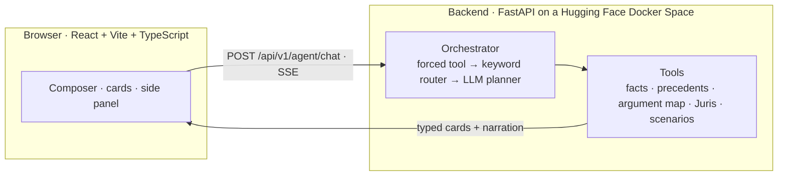

<div align="center">

# ⚖️ LITEngine

### Legal Intelligence Terminal — AI-assisted research for Indian case law

Ask a question in plain language, drop in a judgment, and get precedents, an argument map and an
indicative outcome estimate back as inline cards — each with its sources and caveats.

[](https://lit-ngin.vercel.app)
[](https://lit-ngin.vercel.app/demo)


</div>

---

## What it does

LITEngine replaces a tabbed legal-research workspace with a single full-screen chat. You type a question, or pick a
tool from the **+** menu, and an orchestrator decides which analyses to run. Results render as typed cards inside
the conversation, and every claim points back to the passage it came from.

| Tool | What you get |
|---|---|
| **Read the case** | A structured case profile: parties, legal issues, sections and acts, court level, key facts, relief sought |
| **Find precedents** | The closest judgments from a 505-judgment library (13,591 passages), with the matching passage highlighted in context |
| **Map the argument** | An interactive argument graph (Cytoscape) that opens full screen |
| **Assess the outcome** | **Juris**, a trained outcome model for criminal appeals, rounded to 5 % with its main driver named |
| **Explore scenarios** | Change the appeal type or the cited sections and watch Juris re-score the case |
| **Ask about the case** | Questions answered from your uploaded document, with citations |
| **Full case review** | All of the above in one run |

You can upload a `.pdf`, `.docx` or `.txt`, paste text, or start from a sample matter. Light and dark themes, and
it works on a phone. Conversations live in your browser (IndexedDB); there are no accounts and nothing is stored
server-side.

> **Want to see it first?** Open the [sample session](https://lit-ngin.vercel.app/demo): a recorded run of the real
> system on a fictional matter. It replays offline and needs no backend.

## How it works



- **Hybrid routing.** Explicit picks and obvious intents go through a fast, deterministic path. The language model
  only plans ambiguous or multi-step requests, and it can fail without failing the run.
- **The model cannot forge a card.** Cards come only from server-side tools. The LLM writes prose around them and
  may cite only the source handles the tools issued; anything else is stripped as it streams.
- **Retrieval** uses MiniLM embeddings computed on the server and a FAISS index, so precedent search needs no
  external API.
- **Privacy in logs.** Logs carry lengths, hashes and counts, never case text, queries or file names.

The full design is in [`docs/ARCHITECTURE.md`](docs/ARCHITECTURE.md) and the streaming protocol in
[`docs/PROTOCOL.md`](docs/PROTOCOL.md).

## Juris, the outcome model

Juris estimates the chance that a **criminal appeal** gets any appellate relief. It is trained on **107,847 High Court
criminal-appeal judgments (2008–2026)** and reads only the part of a case that comes *before* the court's reasoning,
plus the appeal type the user states. It never sees the appellate court's own reasoning or order.

| Held-out test: 32,573 later cases (2023–26), read once | Accuracy | AUC |
|---|---|---|
| **Juris** | **75.3 %** (95 % CI 74.8–75.8) | **0.795** |
| Always predict the majority outcome | 65.6 % | — |
| Appeal type alone | 73.7 % | 0.643 |

It can also abstain: 80.1 % accuracy at 80 % coverage, and 90.1 % at 30 %. Appeals filed by the State are scored by
their own model, because the joint model could not rank them (AUC 0.50 → 0.73 within State appeals).

Reading the full judgment text would score 90.7 %, but that includes the court's own reasoning, so it is a reference
point and not a prediction. The strength here is the measurement, not the headline number: a time-based split,
leakage controls, and a test set that is looked at once. Juris is a respectable, defensible baseline, not a
state-of-the-art claim.

Details: [`docs/MODEL_CARD.md`](docs/MODEL_CARD.md) · [`docs/JURIS_ROBUSTNESS.md`](docs/JURIS_ROBUSTNESS.md) ·
[`docs/JURIS_DATASHEET.md`](docs/JURIS_DATASHEET.md)

> ⚠️ **Not legal advice.** The outcome estimate is an indicative research aid. Read the model card for what it is
> and what it is not.

## Quick start

**Frontend** (Node.js and npm). The sample session works with no backend:

```bash
cd lit-frontend
npm install
npm run dev          # http://localhost:3000  ·  open /demo for the recorded session
```

**Backend** (Python 3.11):

```bash
cd lit-backend
python3.11 -m venv venv && source venv/bin/activate
pip install -r requirements.txt
cp .env.example .env            # set HUGGINGFACE_API_KEY, or LLM_PROVIDER=none for fully deterministic mode
uvicorn main:app --reload       # http://localhost:8000  ·  API docs at /docs
```

On macOS, running FAISS and PyTorch in one process needs
`export OMP_NUM_THREADS=1 TOKENIZERS_PARALLELISM=false KMP_DUPLICATE_LIB_OK=TRUE`.

**What a fresh checkout does not include.** The 505-judgment precedent library and the trained Juris artifact
(7.8 MB) are published to a private dataset repository and verified by sha256 at startup, so they are not in this
repo. Without them the backend falls back to a 3-case fixture index and a heuristic estimate, and says so in
`/api/v1/health/ready`. [`lit-backend/scripts/juris/`](lit-backend/scripts/juris/) documents how to rebuild the
Juris pipeline from the public High Court archive.

**Run every check** with one command (needs a Python 3.11 venv at `lit-backend/.venv311`):

```bash
scripts/verify.sh            # backend tests, OpenAPI drift, frontend typecheck / lint / tests / build
scripts/verify.sh --fast     # skip the production build
scripts/verify.sh --e2e      # add the Playwright end-to-end and accessibility suite
```

## Repository layout

| Path | What lives there |
|---|---|
| [`lit-backend/`](lit-backend/) | FastAPI service: streaming agent, precedent search, fact extraction, argument graph, Juris, scenario engine |
| [`lit-frontend/`](lit-frontend/) | React + Vite + TypeScript client on a design-token system |
| [`docs/`](docs/) | Architecture, protocol, model card, robustness report, datasheet, runbook, demo notes |
| [`scripts/verify.sh`](scripts/verify.sh) | One command for every check |
| [`CHANGELOG.md`](CHANGELOG.md) | What changed in each release, and the known limitations |

## Tech stack

| Layer | Built with |
|---|---|
| Frontend | React 18, TypeScript, Vite, Tailwind CSS, Radix UI, Cytoscape.js, self-hosted Inter and Newsreader fonts |
| Backend | Python 3.11, FastAPI, Pydantic v2, Server-Sent Events, scikit-learn |
| Retrieval | sentence-transformers (MiniLM), FAISS |
| Language model | Optional: planning and narration through the Hugging Face router, with a fallback chain, a circuit breaker and a daily token cap. `LLM_PROVIDER=none` runs deterministically |
| Hosting | Vercel (frontend), Hugging Face Docker Space (backend) |
| Quality | pytest, Vitest, Playwright, axe (WCAG 2.1 AA in both themes at 390 px), a bundle-size budget |

## Status and limitations

- Current release: **1.0.1**. Juris (the retrained outcome model) is the newest work and is listed under
  *Unreleased* in the changelog.
- The outcome estimate covers **criminal appeals only** and is weak by construction on some cases; see the model card.
- No accounts, access control or server-side history.
- No OCR, so scanned PDFs are not read.
- The recorded sample session reflects the model and prompt at recording time.

## Branches

- **`feat/juris`** (default): the current line, with the chat workspace (1.0.0), the 1.0.1 polish, and Juris.
- **`main`**: the earlier 0.1.0 tabbed workspace.
- `feat/v1.0.0-chat`, `feat/harvey-style`: feature branches kept for history.

## License

No license has been chosen yet, so all rights are reserved by default.
